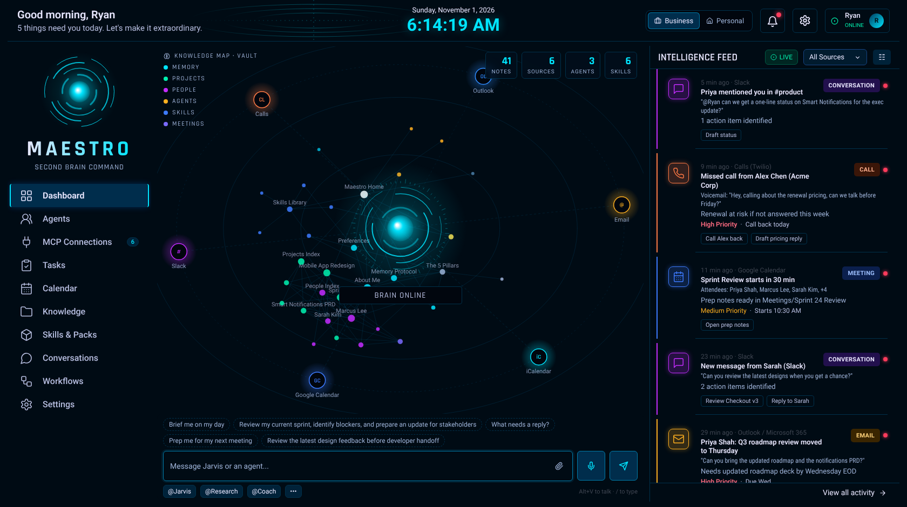

# 🧠 Maestro: your AI second brain

**Claude + Obsidian + MCP, in one download.** Maestro is a personal AI second brain that runs on your own computer. It reads your notes, listens to your email, calendars, Slack, texts and calls, remembers what matters about you, and answers by chat or voice from a browser dashboard and from Claude Desktop.

It is built for the **Build Your Brain** workshop: everything works out of the box with demo data, so you can see the whole brain in action in under five minutes, then connect your real accounts when you're ready.



---

## Quick start (5 minutes)

**You need:** [Node.js 18.17+](https://nodejs.org) (LTS), Chrome or Edge, and ideally [Obsidian](https://obsidian.md/download) and [Claude Desktop](https://claude.ai/download).

1. **Install and start with one line** (recommended, no security prompts):
   - **Mac:** open **Terminal** (⌘Space, type Terminal) and paste:
     `curl -fsSL https://raw.githubusercontent.com/Techr-hub/maestrobrain/main/install.sh | bash`
   - **Windows:** open **PowerShell** and paste:
     `irm https://raw.githubusercontent.com/Techr-hub/maestrobrain/main/install.ps1 | iex`

   This puts Maestro in `maestro-brain` in your home folder and starts it.
2. **Or download the ZIP:** [main.zip](https://github.com/Techr-hub/maestrobrain/archive/refs/heads/main.zip), unzip it, then:
   - **Mac:** macOS blocks double-clicking downloaded scripts. Open **Terminal**, type `bash ` (with a space), drag `Start Maestro.command` into the window and press Enter. To allow double-click from then on: try to open it once, then **System Settings → Privacy & Security → Open Anyway**.
   - **Windows:** double-click `Start Maestro.bat` (if SmartScreen appears: **More info → Run anyway**).
   - **Or in a terminal:** `cd maestro-brain` then `npm start`.
3. Your browser opens **http://localhost:4141**. Follow the 1-minute setup: connect your **knowledge base** (your Obsidian vault, any Markdown folder, or a third party like Notion; the starter vault works out of the box), your name, your role pack, and **Connect to Claude Desktop**.
4. **Restart Claude Desktop** (fully quit, then reopen). Ask Claude: *"Use Maestro to brief me on my day."*
5. **Open the vault in Obsidian:** *Open folder as vault* → choose the `vault` folder inside Maestro.

There is nothing to `npm install`: Maestro has zero dependencies, so it works on locked-down laptops and bad conference Wi-Fi. Run `npm test` to check your install.

---

## The 5 pillars

| Pillar | In Maestro |
|---|---|
| **1. Interaction layer** | Browser dashboard with chat and voice, plus Claude Desktop |
| **2. AI reasoning engine** | Claude (default), or ChatGPT, Gemini, Hermes / any OpenAI-compatible model. An offline **demo brain** needs no key |
| **3. Integration layer (MCP)** | Email, Gmail, Outlook, iCalendar, Google Calendar, Slack, texts and calls (Twilio), plus role tools (Linear, Jira, Notion, Figma, Drive, GitHub, docs) |
| **4. Knowledge sources** | An Obsidian vault of plain Markdown: projects, people, meetings, decisions, tasks |
| **5. Memory protocol** | `Memory/About Me`, `Preferences`, `Memory Log` and the rules in `Memory Protocol`. Say "remember that…" and it's written to the vault |

---

## What's on the dashboard

- **Brain map (centre):** a 3D world you can explore: drag to orbit, right-drag or Shift-drag to pan, scroll or pinch to zoom, double-click to reset (it slowly auto-rotates when idle). The reasoning core is surrounded by your knowledge (vault notes linked by `[[wikilinks]]`, grouped into lobes by folder) and an orbit of connected sources. Notifications fly in as particles; notes the brain used for an answer light up.
- **Chat + voice:** type, or press the mic (or **Alt+V**) and talk. The brain core in the map **pulses while you speak** and **spins while the brain answers**, and holds still otherwise. Replies can be read aloud. Start with *"Hey Maestro…"*; hands-free mode listens for it. Ask straight questions too: *"When did Alex call me?"*, *"Did Priya email me?"*, *"When is my meeting with Sarah?"*.
- **@agents:** `@Maestro`, `@Research`, `@Coach`, plus `@Product`, `@Design`, `@Dev` from role packs.
- **Five default hubs** orbit the brain: **Email, Calendar, Messages, Calls and Projects**. Each service you connect (Gmail, Outlook, iCalendar, Slack, Linear…) appears next to its hub. **Calls** always shows Google Meet, Phone, Teams and Zoom, and **Messages** always shows Text and WhatsApp, as smaller nodes in shades of the hub's colour (dimmed until connected). Click a hub or a service to open it in the feed panel: Calendar shows your schedule for the next 7 days, Projects shows your project notes, and the others show recent activity. A hub with nothing connected (dimmed), or a service with an error, shows a notification with a **Make Connection** button.
- **Projects page** (folder icon in the sidebar): create a project with its name, description, client, start date, milestones and completion date, then add tasks to it. Each project is a note in `Projects/`; its card shows the details, milestones and tasks (tick or add them right there). New projects join the Projects hub on the brain map with a glow beam.
- **Focus and reminders**: ask Maestro "What should I work on first?", "What could stop me hitting my goals?" or "How is the Acme project going?". It ranks open tasks by due date, priority and project deadlines, and flags overdue work, milestones close with open tasks, projects behind schedule, a packed calendar and urgent messages. Pick how far ahead you are reminded of tasks and milestones (1 week, 2 days, 1 day, 12 h, 8 h, 3 h, 2 h, 1 h, 30 min) in Settings → Reminders.
- **Two-way calendar sync**: sign in to Google Calendar or Outlook on their cards (or add your Apple ID to the iCalendar card) and every edit, delete and new event in Maestro updates the real calendar. Event cards have a ⋮ menu with Edit and Delete. One-time OAuth app setup: [docs/CALENDAR-SYNC.md](docs/CALENDAR-SYNC.md).
- **Intelligence Feed (right):** every notification normalised into one card: category, source, priority, deadline, progress and suggested actions (click an action to make it a task).
- **Business / Personal switch (top):** each profile has its own connections, feed and notes (`Personal/` notes are only used in Personal mode).
- **Pages:** Agents · MCP Connections · Tasks · Calendar · Knowledge · Skills & Packs · Conversations · Workflows · Settings.

---

## Connect Claude Desktop

The dashboard button (MCP Connections → **Connect to Claude Desktop**) or `npm run connect-claude` adds Maestro to `claude_desktop_config.json` (a backup is saved first):

```json
{
  "mcpServers": {
    "maestro": {
      "command": "/path/to/node",
      "args": ["/path/to/maestro-brain/mcp/server.js"]
    }
  }
}
```

Restart Claude Desktop. Claude now has these tools: `maestro_brief`, `search_brain`, `read_note`, `write_note`, `remember`, `get_memory`, `get_feed`, `get_calendar`, `list_tasks`, `add_task`, `complete_task`, `log_decision`, `list_skills`, `get_skill`, `list_agents`, `get_agent`, `create_skill`, `create_agent`, `list_connections`, `switch_profile`. Every skill and agent also appears in Claude's **+** menu as a prompt.

For live email, calendar and Slack inside Claude, also turn on Claude Desktop's own connectors (Settings → Connectors: Gmail, Google Calendar, Slack, Microsoft 365, Notion, Linear, Figma, GitHub…). Claude uses them together with Maestro's memory and notes.

---

## Connections: demo vs live

**Knowledge base:** the first card on MCP Connections. Point Maestro at an Obsidian vault (vaults you've opened in Obsidian are detected automatically), any folder of Markdown files, or a custom third-party source that Claude reaches through its connector (Notion, Google Drive, Confluence, OneDrive or another MCP server). Maestro adds its Memory, Agents, Skills and Templates folders to your vault without overwriting anything.

Each card shows a blue **Connect** button, or a green **Connected** button once it's connected. Click Connected to change settings or disconnect.

Every connector works in **demo mode** instantly. Going live:

| Connector | Live in the dashboard | Live in Claude Desktop |
|---|---|---|
| iCalendar (iCloud) | ✅ paste the public ICS link | |
| Google Calendar | ✅ paste the *secret address in iCal format* | ✅ Google Calendar connector |
| Outlook / Microsoft 365 | ✅ calendar via published ICS link | ✅ Microsoft 365 connector |
| Slack | ✅ bot token + channel IDs | ✅ Slack connector |
| Text messages / Phone calls | ✅ Twilio Account SID, auth token, number | |
| WhatsApp | ✅ Twilio WhatsApp sender or sandbox | |
| Google Meet, Microsoft Teams, Zoom | demo | ✅ Google Calendar + Drive / Microsoft 365 / Zoom connectors |
| Gmail, other email | demo | ✅ Gmail connector / an IMAP MCP server |
| Linear, Jira, Notion, Figma, Drive, GitHub, docs | demo | ✅ their Claude connectors |

Details and step-by-step setup: [docs/CONNECTORS.md](docs/CONNECTORS.md).

---

## Build out your brain: packs, agents and skills

- **Role packs** (Skills & Packs page): *Product Manager*, *Design & Marketing*, *Entrepreneur & Builder*. A pack adds connectors, a specialist agent, skills and a playbook note. Packs live in `packs/<name>/` and you can write your own (a `pack.json` and a `vault/` folder).
- **Agents** are Markdown files in `vault/Agents/`: frontmatter (`handle`, `role`, `color`, `provider`, `model`, `baseUrl`) and the body is the agent's instructions. Create them in the dashboard, in Obsidian, by importing a `.md`, or by asking Claude ("create a Maestro agent that…").
- **Skills** are Markdown playbooks in `vault/Skills/` with `description` and `triggers`. The dashboard runs a skill when your message matches a trigger.
- **Load into Claude:** with Maestro connected, Claude sees every agent and skill automatically. You can also **download them as Claude Skills** (Skills & Packs → *Download all*) and upload them in Claude (Settings → Capabilities → Skills) or unzip them into `~/.claude/skills` for Claude Code. Each one points Claude at your Maestro knowledge base, so every agent and skill shares the same brain.

---

## AI engines (Settings → AI engine)

| Engine | What you need |
|---|---|
| Demo brain | Nothing. Offline answers from your vault, feed and calendar |
| Claude | Anthropic API key (default model `claude-opus-5-5`) |
| ChatGPT | OpenAI API key |
| Gemini | Google AI Studio key |
| Hermes / open models | [Ollama](https://ollama.com) (`ollama pull hermes3`, base URL `http://localhost:11434/v1`), or OpenRouter / Nous Portal / LM Studio / any OpenAI-compatible endpoint |

Individual agents can use a different engine from the rest of the brain (e.g. `@Research` on Gemini, a `@Hermes` agent on Ollama).

---

## Proactive workflows

Morning brief, meeting prep (before each meeting), inbox triage (hourly) and end-of-day wrap-up run on their own while the dashboard is running. They write into today's `Daily/` note and push a card into the feed. Press **Run now** on the Workflows page to demo them.

---

## Project layout

```
maestro-brain/
├── install.sh / install.ps1        one-line installers (Mac / Windows)
├── Start Maestro.command / .bat   start scripts (Mac / Windows)
├── bin/maestro.js                 CLI: start | setup | connect-claude | reset
├── server.js                      dashboard server + API (Node built-ins only)
├── mcp/server.js                  MCP server for Claude Desktop (stdio)
├── core/                          the brain: vault, memory, feed, connectors, LLMs, agents, packs, workflows
├── public/                        the browser dashboard (no build step)
├── vault/                         starter Obsidian vault
├── packs/                         role packs
└── data/                          your settings, feed and chat history (created on first run, never shared)
```

## Privacy

Everything runs on `localhost`. Your notes stay in the vault folder, settings and keys stay in `data/config.json` on your machine, with a copy in your knowledge base (`.maestro/settings.json`, hidden from Obsidian) and in `~/.maestro/settings.json`, so a new download or a new computer pointed at the same vault keeps your connections, and nothing is sent anywhere unless you connect an AI engine or a live source. `npm run package` builds a shareable ZIP that leaves out `data/` and your Daily and Inbox notes.

## Troubleshooting

| Problem | Fix |
|---|---|
| "node is not recognized" / "command not found" | Install Node.js LTS from nodejs.org, then reopen the terminal |
| Mac won't open `Start Maestro.command` ("Apple could not verify…" or "not allowed") | Use the one-line installer, or in Terminal run `bash ` + drag the file in. To allow double-click: System Settings → Privacy & Security → Open Anyway |
| Port 4141 in use | Maestro picks the next free port automatically, so check the terminal for the URL |
| Claude Desktop doesn't show *maestro* | Fully quit Claude Desktop (not just close the window) and reopen; check Settings → Developer for MCP logs |
| Mic button does nothing | Use Chrome or Edge, allow microphone access for localhost |
| Want a fresh demo | Settings → Demo → Reset demo feed, or `npm run reset-demo` |

MIT licence.
